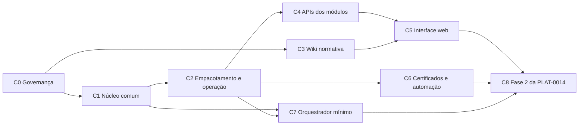

# Plano de convergência da plataforma

Como os módulos que hoje funcionam sozinhos (folha no `blatt`, captura de documentos fiscais no
`aspirador`) passam a funcionar como uma plataforma: operados juntos, integrados por fatos,
com uma interface web e uma wiki de uso e de normas.

- **Situação:** proposta de 08/11/2026, para revisão do Marcello. Não é uma ADR: organiza a
  ordem do trabalho. Cada etapa que muda uma regra de plataforma gera a sua ADR `PLAT-`, e só
  ela decide.
- **Atualização:** ao fim de cada etapa, a sessão que a concluiu atualiza a coluna "Situação"
  e a seção "Onde estamos".

## Onde estamos (08/11/2026)

| Repositório | Situação | Fonte |
| --- | --- | --- |
| `blatt` (folha) | Etapas 1 a 4 concluídas; 5 e 6 em andamento, aguardando P-37 a P-40; piloto (Etapa 7) a fazer. Só linha de comando. Um banco com os schemas `cadastro` e `folha`, sem `outbox` | [ROADMAP](https://github.com/marcellohalfeld/blatt/blob/main/docs/ROADMAP.md) |
| `aspirador` | Download pelo ADN e importação de XML em produção; banco próprio com `outbox` (fase 1 da PLAT-0014) validado com dados reais. Só linha de comando | [ROADMAP](https://github.com/marcellohalfeld/aspirador/blob/claude/admiring-mendel-vilgsf/docs/ROADMAP.md) |
| `oper` (orquestrador) | Vazio | — |
| `assembleia` | ADRs `PLAT-`, resumo, índice de contratos, `blatt.comum` canônico | [README](../README.md) |
| Interface web, distribuição | Não existem | — |

Três constatações ordenam o plano:

1. **Ninguém consome os fatos publicados hoje.** O aspirador grava `fiscal.documento_coletado` e
   `fiscal.documento_cancelado` na `outbox`, mas o consumidor natural, o
   `fiscal.escrituracao` (ASP-0006), não existe, e a folha só publica na fase 2. Um orquestrador
   feito agora só entrega a um consumidor de teste: valida o contrato, mas não muda nada para
   quem usa.
2. **A wiki normativa não depende de API nem de orquestrador.** O conteúdo já existe no blatt,
   estruturado: `parametros/tabelas/` (valor, vigência, base legal com dispositivo e link, hash)
   e `docs/dominio/regras/` (base legal, regra, parâmetros, interpretação adotada, casos-ouro).
   É a entrega mais barata e mais útil para um escritório de contabilidade.
3. **O certificado A1 é o gargalo da automação.** Hoje ele nunca é gravado: o aspirador lê o
   `.pfx` a cada execução, e a transmissão da folha roda no computador do Marcello. Qualquer
   serviço que colete ou transmita sozinho depende do OpenBao (PLAT-0006) e de uma rotina de
   *unseal*.

Restrição que vale para todas as etapas: **a folha não muda durante o MVP dela** (PLAT-0014,
item 10), salvo o que este plano pede explicitamente, que é só acréscimo de adaptador (imagem,
API) e nunca mudança de banco, de domínio ou de escopo. Cada acréscimo desses na folha é
confirmado pelo Marcello antes (decisão D2).

## Etapas

| # | Etapa | Entrega | Onde | Depende de | Pronto quando | Situação |
| --- | --- | --- | --- | --- | --- | --- |
| C0 | Governança | Aceite da PLAT-0015 (A-01), classificação das ADRs (A-02), status das `PLAT-` propostas (A-06), ADR com o mapa de módulos e o escopo do MVP da plataforma (A-05) | `assembleia` | — | A-01, A-02, A-05 e A-06 resolvidas | Em revisão |
| C1 | Núcleo comum | `blatt.infra` canônico no `assembleia`, como o `comum` (A-07); conferência do `comum` e do `infra` no CI de cada módulo (A-03, opção 2) | `assembleia`, `blatt`, `aspirador` | C0 | CI dos dois módulos falha se a cópia divergir do manifesto | — |
| C2 | Empacotamento e operação | ADR de operação (A-08); imagem OCI de cada módulo com a CLI atual e um comando `migrar`; repositório de distribuição com o Compose (PostgreSQL com um banco e um usuário por módulo, migrações que rodam uma vez, módulos, backup) | `blatt`, `aspirador`, distribuição | C1 | `docker compose up` no Mac do Marcello sobe o PostgreSQL, migra os bancos da folha e do aspirador e roda os comandos que hoje rodam fora de container, com os mesmos resultados dos casos-ouro | — |
| C3 | Wiki normativa | ADR do contrato do conteúdo normativo (A-10); gerador estático que lê `parametros/` e `docs/dominio/regras/` dos módulos numa versão fixada; tabelas por vigência, regra, base legal com link, interpretação adotada e quem decidiu | repositório da interface | C0 | Wiki gerada da versão em uso do blatt, com INSS, IRRF e FGTS de 2026 e de vigências anteriores, cada valor ligado ao seu ato normativo | — |
| C4 | APIs dos módulos | ADR das APIs e da interface (A-09): API HTTP por módulo sobre os casos de uso existentes, contrato publicado pelo módulo e listado no `assembleia`, autenticação, e a interface como único cliente síncrono (um módulo continua sem chamar outro, PLAT-0014, item 3) | `assembleia`, `blatt`, `aspirador` | C2 | API da folha (consultar e gerar folha, conciliar) e do aspirador (documentos, receita) no Compose, com os contratos no índice | — |
| C5 | Interface web | Login, escolha de empresa e competência, telas da folha e do aspirador; wiki da C3 servida com o mesmo login; manual de uso; link de cada valor calculado para a regra, a tabela vigente e a norma | repositório da interface | C3, C4 | Uma competência da empresa de teste conferida do começo ao fim pela interface, sem linha de comando | — |
| C6 | Certificados e automação | OpenBao no Compose, com rotina de *unseal* e de backup das chaves; coleta agendada no aspirador; transmissão da folha a partir do servidor | distribuição, `aspirador`, `blatt` | C2 | Coleta agendada rodando uma semana sem intervenção, com o certificado só no OpenBao | — |
| C7 | Orquestrador mínimo | ADR que antecipa parte do item 11 da PLAT-0014 (A-04); leitura da `outbox` do aspirador, inscrições, entrega numa `inbox`, nova tentativa e registro; consumidor de teste | `oper`, `assembleia` | C1, C2 | Os 71 fatos reais da `outbox` do aspirador entregues uma única vez a um consumidor de teste, com reentrega depois de queda simulada | — |
| C8 | Fase 2 da PLAT-0014 | Depois do MVP da folha: bancos separados de `folha` e `cadastro`, `outbox` e `inbox` na folha e no cadastro, fatos da folha publicados, `fiscal.escrituracao` consumindo os fatos do aspirador | todos | C5, C6, C7 e o piloto da folha | Um fato real da folha e um do aspirador consumidos por outro módulo através do orquestrador | — |

### O que cada etapa exige da folha

| Etapa | Mudança no `blatt` | Toca banco, domínio ou escopo? |
| --- | --- | --- |
| C1 | Conferência do `comum` e do `infra` no CI | Não |
| C2 | `Containerfile` e comando `migrar` (já existe o executor de migrações) | Não |
| C3 | Nenhuma: o gerador só lê o repositório | Não |
| C4 | Adaptador HTTP de entrada, ao lado das CLIs | Não; mas é acréscimo e depende de D2 |
| C6 | Transmissão lendo o certificado do OpenBao (adaptador novo do port que já existe) | Não |
| C8 | Tudo o que o item 11 da PLAT-0014 prevê | Sim, por isso fica depois do MVP |

## Ordem sugerida

1. **C0 e C1 primeiro.** São pequenas e evitam que as etapas seguintes nasçam sobre cópias
   divergentes (o `blatt.infra` já diverge, A-07).
2. **C3 em paralelo com C2.** A wiki é a primeira entrega visível e não depende de nada além do
   conteúdo que o blatt já tem. Ela também testa o repositório da interface sem precisar de
   API.
3. **C2 antes de C4, C6 e C7.** Tudo o que vem depois roda no Compose; empacotar primeiro evita
   construir serviços que depois precisem ser adaptados a containers.
4. **C4 e C5 antes do piloto da folha**, se a interface for parte do MVP (decisão D1). Caso
   contrário, o piloto roda pela CLI e C4 e C5 vêm depois.
5. **C7 quando houver consumidor real**, ou antes, só para validar o contrato (decisão D3).
6. **C8 depois do piloto**, como a PLAT-0014 manda.

## Decisões do Marcello

| # | Decisão | Opções | Proposta | Afeta |
| --- | --- | --- | --- | --- |
| D1 | A interface web faz parte do MVP da folha (antes do piloto)? | Sim: C4 e C5 entram antes da Etapa 7 do blatt. Não: o piloto roda pela CLI | Sim: um escritório real dificilmente opera pela linha de comando | Ordem de C4, C5 e Etapa 7 |
| D2 | Acréscimos de adaptador na folha (imagem, API, certificado pelo OpenBao) contam como "a folha não muda" do item 10 da PLAT-0014? | Sim, por não tocarem banco, domínio nem escopo. Não: só depois do MVP | Sim, registrado na ADR de C4 | C2, C4, C6 |
| D3 | O orquestrador começa agora, com consumidor de teste, ou só quando houver consumidor real? | Agora (valida o contrato cedo). Depois (nada é construído sem uso) | Depois de C2, com consumidor de teste, mas sem prioridade sobre C3 a C5 | C7 |
| D4 | Nome e criação dos repositórios da interface e da distribuição | — | Criados pelo Marcello; as sessões não criam repositório (A-11) | C2, C3 |
| D5 | A parte normativa da wiki pode ser publicada abertamente? | Só dentro da instalação. Também como site público | Gerar como site estático desde o início, para manter as duas portas abertas; decidir a publicação depois | C3 |

## Como as sessões trabalham neste plano

- Cada etapa tem uma sessão com objetivo declarado, que anexa o `assembleia` e os repositórios
  da coluna "Onde".
- A ADR `PLAT-` da etapa vem antes do código. Enquanto ela estiver Proposta, a etapa pode
  avançar em branch, mas não entra na `main` dos módulos.
- O que muda num módulo vai em PR no repositório dele; o que muda na plataforma, em PR aqui.
- Pendência de decisão vai para `docs/PENDENCIAS.md` daqui (se for de plataforma) ou do módulo.

## Referências

- [PLAT-0014](adr/PLAT-0014-banco-por-modulo-e-orquestrador.md): item 3 (consulta síncrona como
  exceção), itens 6 a 8 (orquestrador, contratos, fila), itens 10 e 11 (fases).
- [PLAT-0002](adr/PLAT-0002-arquitetura-hexagonal.md) (adaptadores de entrada),
  [PLAT-0004](adr/PLAT-0004-instancia-por-escritorio.md) (instância por escritório),
  [PLAT-0006](adr/PLAT-0006-infraestrutura-aberta.md) (containers, OpenBao),
  [PLAT-0015](adr/PLAT-0015-governanca-no-assembleia.md) (governança).
- Folha: [ROADMAP](https://github.com/marcellohalfeld/blatt/blob/main/docs/ROADMAP.md),
  [regras de cálculo](https://github.com/marcellohalfeld/blatt/blob/main/docs/dominio/regras/README.md),
  [parâmetros](https://github.com/marcellohalfeld/blatt/blob/main/parametros/README.md),
  [eventos previstos](https://github.com/marcellohalfeld/blatt/blob/main/docs/contratos/eventos-dominio.md).
- Aspirador: [ROADMAP](https://github.com/marcellohalfeld/aspirador/blob/claude/admiring-mendel-vilgsf/docs/ROADMAP.md),
  [ASP-0006 (escopo de captura)](https://github.com/marcellohalfeld/aspirador/blob/claude/admiring-mendel-vilgsf/docs/adr/0006-escopo-de-captura.md).
- [Docker Compose: ordem de inicialização dos serviços](https://docs.docker.com/compose/how-tos/startup-order/).
- Gerador da wiki, para a ADR de C3: [MkDocs (licença BSD)](https://mkdocs.readthedocs.io/en/859/about/license/);
  o tema Material for MkDocs chega ao fim da vida útil em 05/05/2027
  ([PyPI](https://pypi.org/project/mkdocs-material)); o sucessor Zensical é MIT, em versão 0.0.x
  ([licença](https://zensical.org/license/)).
